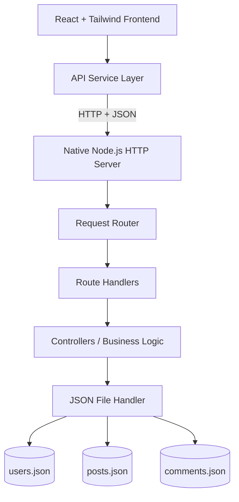

# InkSpace — Stories Worth Sharing. Ideas Worth Reading.

<p align="center">
  
  
</p>

<p align="center">
  <strong>A modern, editorial-style blogging platform built for readers, writers, and curious minds.</strong>
  <br/>
  Discover ideas. Create stories. Build a community around what matters.
</p>

<p align="center">
  <a href="#-overview">Overview</a> •
  <a href="#-features">Features</a> •
  <a href="#-tech-stack">Tech Stack</a> •
  <a href="#-architecture">Architecture</a> •
  <a href="#-getting-started">Getting Started</a> •
  <a href="#-roadmap">Roadmap</a>
</p>

---

## ✦ Overview

InkSpace is a full-stack blog platform designed to bring a clean, distraction-free reading experience together with a powerful writing and content-management workflow.

Inspired by modern editorial websites, InkSpace focuses on thoughtful typography, immersive article layouts, intuitive navigation, and a streamlined publishing experience.

Whether someone wants to explore technology, share a personal perspective, or publish their next big idea, InkSpace aims to provide a place where good stories find their readers.

The project is being developed incrementally, starting with a responsive React frontend and progressing toward a native Node.js backend with JSON-file persistence.

> **Our philosophy:** Great content deserves an equally thoughtful experience.

### ✧ What makes InkSpace different?

- **Editorial-first design** — clean layouts, expressive typography, and content-focused interfaces.
- **A writer-centric workflow** — a dedicated space to draft, organize, edit, and publish articles.
- **Discoverability by design** — categories, tags, search, and related content.
- **A modular architecture** — reusable React components and clearly separated backend responsibilities.
- **Learning through implementation** — built step by step, from frontend fundamentals to backend APIs and authentication.

---

## 🚀 Features

### 📖 Reading & Discovery
- Responsive editorial homepage.
- Featured and popular articles.
- Article discovery through categories and tags.
- Search, filtering, and sorting.
- Individual article pages with readable typography.
- Author information and estimated reading time.
- Related article recommendations.

### ✍️ Writing & Publishing
- Dedicated author dashboard.
- Create, edit, and manage blog posts.
- Draft and published content states.
- Article metadata, categories, and tags.
- Cover image support.
- Markdown authoring and preview, planned as part of the editor.
- Post-management interface.

### 👤 User Experience
- Login and registration interfaces.
- User profile and settings.
- Bookmarked articles.
- Like and comment interactions.
- Responsive layouts for desktop, tablet, and mobile.

### 🛡️ Administration
- Admin dashboard.
- User and role management.
- Content management.
- Comment moderation.
- Platform overview and statistics.

> [!NOTE]  
> **Implementation note:** The feature list describes the platform's intended scope. Individual capabilities will become available as their development phases are completed. Real authentication, persistent interactions, and administrative permissions require backend implementation.

---

## 🎨 Design Philosophy

InkSpace uses a minimal, editorial visual language designed to keep attention on the content.

| Element | Design direction |
| :--- | :--- |
| **Typography** | Expressive serif headlines and readable sans-serif interface text |
| **Colors** | Warm white, near-black, muted gray, restrained accents |
| **Layout** | Generous whitespace and balanced editorial grids |
| **Components** | Reusable cards, forms, navigation, and content sections |
| **Interactions** | Subtle transitions, image hover effects, clear feedback |
| **Responsiveness** | Adaptable layouts across screen sizes |
| **Accessibility** | Semantic structure, visible focus states, keyboard-friendly controls |

---

## 🛠️ Tech Stack

### Frontend

<p>
  
  
  
  
</p>

- **React** — component-based user interfaces.
- **Vite** — development server and build tooling.
- **Tailwind CSS** — responsive styling and design consistency.
- **React Router** — client-side navigation.
- **Lucide React** — interface icons.
- **Motion** — UI animations, if included in the current setup.

### Backend

<p>
  
  
  
</p>

- Native Node.js `http` module for HTTP server functionality.
- Native `fs/promises` module for file-based persistence.
- JSON files for development-stage data storage.
- Modular routing, validation, and request handling.
- No Express or MongoDB is required for the initial backend phase. The architecture can evolve as the project progresses.

---

## 🏗️ Architecture

InkSpace separates the user interface, API communication, server-side logic, and data persistence.



### Request lifecycle

1. A user interacts with a page or form.
2. The frontend sends an HTTP request through its API service.
3. The native Node.js server matches the route and HTTP method.
4. The relevant handler validates and processes the request.
5. The file-handling layer reads or updates the relevant JSON data.
6. The server returns a JSON response to the frontend.

This structure keeps responsibilities separate and makes future maintenance easier.

> [!NOTE]  
> JSON-file storage is intended for learning and local development. It is not a substitute for a production database or a multi-user transactional storage system.

---

## 📂 Project Structure

```text
InkSpace/
│
├── client/
│   ├── public/
│   ├── src/
│   │   ├── assets/
│   │   ├── components/
│   │   │   ├── common/
│   │   │   ├── layout/
│   │   │   ├── blog/
│   │   │   ├── auth/
│   │   │   ├── dashboard/
│   │   │   └── admin/
│   │   ├── pages/
│   │   │   ├── public/
│   │   │   ├── auth/
│   │   │   ├── dashboard/
│   │   │   └── admin/
│   │   ├── layouts/
│   │   ├── routes/
│   │   ├── services/
│   │   ├── context/
│   │   ├── hooks/
│   │   ├── data/
│   │   ├── utils/
│   │   ├── App.jsx
│   │   ├── main.jsx
│   │   └── index.css
│   └── package.json
│
├── Server/
│   ├── data/
│   │   ├── users.json
│   │   ├── posts.json
│   │   └── comments.json
│   ├── routes/
│   ├── controllers/
│   ├── services/
│   ├── utils/
│   ├── middleware/
│   ├── router.js
│   ├── server.js
│   └── package.json
│
├── .gitignore
└── README.md
```

*The tree represents the intended project organization. Actual files may differ while implementation is in progress.*

---

## ⚙️ Getting Started

### Prerequisites

Install the following before running the project:
- [Node.js](https://nodejs.org/) — a current LTS release is recommended.
- **npm** — included with Node.js.
- **Git** — for version control.

### 1. Clone the repository

```bash
git clone <YOUR_GITHUB_REPOSITORY_URL>
cd InkSpace
```
*Replace the placeholder with your actual repository URL.*

### 2. Install frontend dependencies

```bash
cd client
npm install
```

### 3. Start the frontend

```bash
npm run dev
```
Open the local URL printed by Vite in your terminal.

### 4. Start the backend

Once the Node.js server has been implemented, open a second terminal:

```bash
cd Server
npm install
npm start
```

The final command requires a `start` script in `Server/package.json`. For example:
```json
{
  "scripts": {
    "start": "node server.js"
  }
}
```

If the backend has not been implemented yet, continue running the frontend independently with its mock data.

### 5. Verify the API

After the server is running, the health-check endpoint should be accessible at:
```text
http://localhost:4000/api/health
```
*The endpoint will be available once implemented.*

---

## 🔌 API Overview

The following endpoints describe the planned API surface. They should be documented as implemented only after they have been built and tested.

| Method | Endpoint | Purpose |
| :--- | :--- | :--- |
| `GET` | `/api/health` | Check server availability |
| `GET` | `/api/posts` | Retrieve published posts |
| `GET` | `/api/posts/:slug` | Retrieve a published article |
| `POST` | `/api/posts` | Create a post |
| `PUT` | `/api/posts/:id` | Update a post |
| `DELETE` | `/api/posts/:id` | Delete a post |
| `POST` | `/api/auth/signup` | Register a user |
| `POST` | `/api/auth/login` | Authenticate a user |
| `GET` | `/api/users/me` | Retrieve the current user profile |
| `GET` | `/api/posts/:id/comments` | Retrieve article comments |
| `POST` | `/api/comments` | Create a comment |

Additional endpoints for bookmarks, likes, roles, and moderation can be introduced in later development phases.

> [!WARNING]  
> **Security:** Write and administration endpoints must be protected before the API is exposed to users. Client-side route guards alone do not provide server-side authorization.

---

## 🗺️ Roadmap

InkSpace is being developed in incremental phases.

- [x] Frontend foundation and initial page layouts
- [x] Editorial visual direction and reusable UI planning
- [x] Native Node.js HTTP server
- [x] JSON-file storage utilities
- [x] Public post endpoints
- [x] Frontend-to-backend integration
- [ ] User registration and authentication
- [ ] Blog post CRUD and publishing workflow
- [ ] Comments, likes, and bookmarks
- [ ] Admin functionality and role-based authorization
- [ ] Testing, security review, and deployment

*Update these checkboxes as each milestone is actually completed.*

---

## 🔐 Security Considerations

Security is an important part of building a publishing platform.

- Validate and normalize incoming request data.
- Hash passwords instead of storing them in plain text.
- Enforce authorization on the server for protected operations.
- Sanitize user-generated content before rendering it as HTML.
- Restrict request sizes and handle malformed JSON.
- Configure CORS for explicitly allowed frontend origins.
- Avoid committing secrets, credentials, or private environment files.
- Treat JSON storage as development infrastructure, not production storage.

---

## 🧪 Testing

As development progresses, test:
- API responses and HTTP status codes.
- Invalid input and malformed requests.
- Post creation, editing, publishing, and deletion.
- Persistence after server restarts.
- Authentication and access-control rules.
- Search, filtering, and pagination.
- Responsive layouts and accessibility.
- Error states and broken-resource handling.

*Only mark tests as passing after they have actually been run.*

---

## 🤝 Contributing

InkSpace is a learning-focused project, and improvements are welcome.

1. Fork the repository.
2. Create a feature branch:
   ```bash
   git checkout -b feature/your-feature
   ```
3. Implement your changes with clear, focused commits.
4. Test your changes locally.
5. Open a pull request explaining the change.

Keep pull requests focused, avoid unrelated changes, and update documentation whenever behavior changes.

---

## 🌱 Future Possibilities

Potential improvements after the core platform is complete:
- Richer Markdown editing and autosave.
- Image hosting and upload support.
- Improved article discovery and recommendations.
- SEO metadata and social sharing previews.
- Newsletter subscriptions.
- Performance optimization and caching.
- Migration from JSON files to a persistent database.
- Automated tests and continuous integration.

*These are future possibilities, not claims about current functionality.*

---

## 👨‍💻 Author

**Ishant Sharma**  
Computer Science Student | Aspiring Software Engineer  
GitHub: [@CipherCraftXIshant](https://github.com/CipherCraftXIshant)

---

## 📄 License

Choose a license before distributing the project publicly. If you decide to use the MIT License, add a LICENSE file containing the appropriate license text and update this section accordingly.

---

<p align="center">
  <strong>InkSpace</strong>
  <br/>
  <em>Every idea deserves a space. Every story deserves a reader.</em>
</p>

<p align="center">
  Built with curiosity, code, and a love for good stories.
</p>
